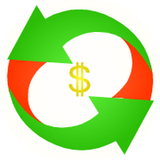

# SENASAL (NAL)

The SENASAL token is the digital asset of SENASAL, led by founder and CEO SNAR SAL. No additional utility is claimed here.

> **Status:** token created on MultiversX. SENASAL has not authorized a sale or created liquidity pools. Token issuance does not imply a released product or operational service.

## Token information

Information supplied by SENASAL; not a live or independently verified feed.

| Field | Value |
|---|---|
| Identifier | `NAL-19d7ed` |
| Blockchain | MultiversX |
| Decimals | 18 |
| Total supply | 84,000,000 NAL |
| Circulating supply shown in the supplied explorer snapshot | 84,000,000 NAL |
| Owner | `erd1cef4ajjsur96w522artqp4uqv5pjydtugsnuept33pdag0xu3utqj6vvlp` |
| Enabled properties shown | Can Upgrade; Can Change Owner; Can Pause; Can Freeze; Can Wipe; Can Add Special Role |
| Pause status shown | Not paused |

Administrative capabilities remain enabled in the supplied snapshot. This does not mean they have been exercised. The explorer circulating figure does not establish public distribution, market liquidity or tradability.

## Official references

- [Token explorer](https://explorer.multiversx.com/tokens/NAL-19d7ed)
- [Project link supplied by SENASAL](https://senasal.com)
- [SENASAL](https://senasal.com)
- [SENASAL on GitHub](https://github.com/SENASAL)

## Security

SENASAL has not authorized any sale of this token. An offer claiming to be an official SENASAL sale is unauthorized. Always verify the identifier. Never share your seed phrase or private keys.

See [SECURITY.md](./SECURITY.md) for private reporting.

## Notice

This page documents the project and token. It does not promise returns, market value or future availability.
